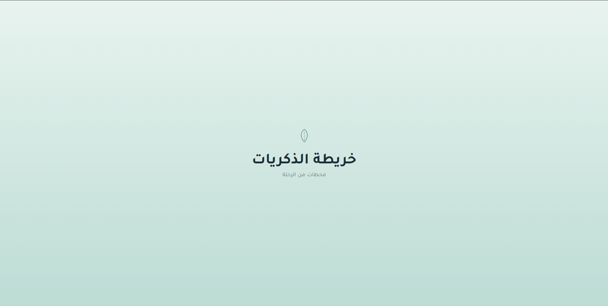
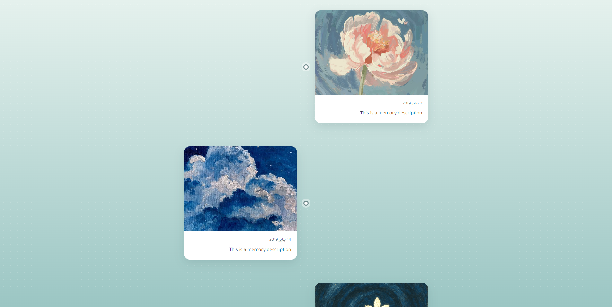

# Memory Map

Show your life memories as a beautiful memory map with images and ability to print it into PDF version!

## Screenshots




## Usage

Run the app using this command in the root directory:

```sh
python -m http.server
```

Then open this url: `http://localhost:8000`

> [!NOTE]
> Keep all images in `4:3` ratio to get the best result

## Features

1. Beautiful and simple design.
2. Optimized PDF version of the content.
